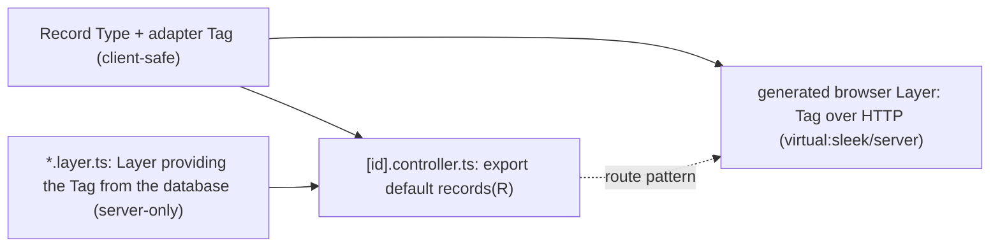

# Served records

## Goal & Context
<!-- scope: business -->

A Record Type (ADR 0041) is the client half of a fullstack data model: Identity Map, Drafts, `commit`, and a Record Adapter that an app writes by hand per type. The server half is missing, and nothing ties the two wire contracts together, so a client adapter and the REST route it calls agree only by convention.

This spec makes one Record Type serve both sides, in the manner of Django REST framework: the record is the serializer (the wire shape and nothing else), the database is behind the adapter Tag and server-only, and one line in a file-routed Controller serves it. The browser's adapter Layer is generated from that Controller's route, so the two cannot drift.

Target: an app developer who wants `record.find`, `commit` and `useDraft` against their own database without writing REST routes, an adapter or a client.

Design record: a new ADR (0057) that supersedes the "no wrapper function" part of ADR 0053 for this one call form. Vocabulary: CONTEXT.md (Record Type, Record Adapter, Controller, Layer File, Server Service). Depends on File-routed Controllers (fn-68) and Server auto-wiring (fn-69).

## Architecture & Data Models
<!-- scope: technical -->

One Tag, a different Layer per side, exactly as a Server Service (ADR 0051):



- The record module and its adapter Tag are client-safe and import nothing server-side. There is no persistence option on `defineRecord`: the database is reachable only from a Layer File, which is server-only (ADR 0054), so `ServerFileInClientGraph` already guards the boundary and nothing relies on tree-shaking.
- The Controller handler calls the adapter Tag directly and answers the wire form. It never calls `record.find` or `record.commit`: those write the Identity Map, a client Store service.
- On the server (SSR, loaders) the same Tag resolves to the Layer File's implementation in-process. In the browser it resolves to the generated HTTP Layer. A Layer File and the generated browser Layer never meet in one composition, so there is no `LayerFileConflict`.
- The generated browser Layer is part of the browser Layer that `virtual:sleek/server` already exports for generated Server Services.
- The Analyzer reads `export default records(X)`, resolves `X` to its `defineRecord` call and the adapter Tag in it, and reports the Tag as a requirement of the served methods, so a Tag nobody provides is the existing `MissingDependency`.

## API Contracts
<!-- scope: technical -->

- `readOnly(schema)` (`@sleekstack/model`): marks a record field the client may read and never writes (`createdAt`, a server counter). `id` is always read-only. Such a field stays in the record and the wire form, and is absent from the Draft's change body, from `RecordChange` and from `record.change`.
- `record.change` (a property of every `RecordDefinition`): the Schema of a PATCH body: every field but `id` and the read-only ones, in wire form, exactly the type `commit` sends (`RecordChange`). Every field is required; a partial body is not accepted.
- `RecordNotFound { type, id }` and `RecordRejected { type, id, message }` (`@sleekstack/model`): tagged errors, the whole failure type of a derived adapter.
- `records(record)` (`@sleekstack/start`): the default export of a Controller file. It serves two methods of the file's route:
  - `GET`: the adapter's `find(id)`, answered as the record's wire form (its fields' Encoded type) as JSON, 200.
  - `PATCH`: the body decoded with `record.change`, then the adapter's `save(id, change)`, answered as the wire form, 200.
  - A `RecordNotFound` answers 404 with `{ "_tag": "RecordNotFound", "type": ..., "id": ... }`; a `RecordRejected` answers 422 with `{ "_tag": "RecordRejected", "type": ..., "id": ..., "message": ... }`. Any other failure reaches `wrap` as it does for every Controller (ADR 0053).
  - `HEAD` and `OPTIONS` follow the Controller defaults. Any other method is `MethodNotAllowed`.
- A served record's route is the file's path, which must end in `[id]`; the generated browser adapter calls `GET <route>` and `PATCH <route>` with the id filled in, a JSON body and `Content-Type: application/json`.
- The browser adapter's failures: 404 is `RecordNotFound`, 400 and 422 are `RecordRejected` (`message` from the body's `message` field, else the status text). Any other status, a network failure, or a body that is not a JSON object is a defect, not a typed failure.
- New `AnalyzeCode` values, each with its table row (rule, fix, docs): `RecordsRouteShape` and `RecordsMethodCollision`.

## Edge Cases & Constraints
<!-- scope: technical -->

- The adapter's `save` returns a wire form whose `id` differs from the route's `id`: the Controller does not check it. `commit` already fails with `SaveResponseError` on the client (ADR 0041), so the server stays thin.
- A response that does not encode through the record's Schema (a row with a missing field) is an encode failure: a defect and an empty 500, as for any Controller whose answer does not encode (ADR 0053).
- A PATCH body that sends a read-only field or any unknown key: the key is dropped by decode, as Effect Schema's default drops excess properties. A body missing an editable field fails decode: a `ParseError` that reaches `wrap`, 400 `DecodeError` unhandled.
- `[id]` decodes as a string; a malformed percent escape is `InvalidPathEncoding`, as for every Controller.
- Authorization lives in the Layer File's implementation, which runs with the request services (ADR 0052) and fails with a tagged error that `wrap` maps. The framework adds no `authorize` hook.
- A record whose Schemas need a Service (`Schema.Struct.Context<F>` not `never`) cannot be served: the Controller decodes and encodes with no Service in scope. `RecordsRouteShape` names it.
- Dev server: editing a records Controller or its record module reloads the declaration like any Controller (fn-68).

## Acceptance Criteria
<!-- scope: both -->

- **R1:** `readOnly(schema)` marks a record field. The field is in the record and the wire form, and is absent from the Draft's change body, from `RecordChange` and from `record.change`; `record.useDraft` never lists it. `id` is read-only without a marker. Errors: `readOnly` of a non-Schema is a type error; marking `id` explicitly is accepted and changes nothing; a `readOnly` field that is a `ref` or `refs` still resolves in `related`.
- **R2:** `record.change` decodes exactly the type `commit` sends: it requires every editable field, drops unknown keys and read-only fields, and fails with a `ParseError` naming the field when an editable one is missing or malformed. Errors: a `field(...)` Transformation field is decoded through its wire form, not its `to` input; a record with no editable field has an empty-object `change` that accepts `{}`.
- **R3:** `RecordNotFound` and `RecordRejected` are exported from `@sleekstack/model` as tagged errors with exactly the fields shown, and a Draft-only bundle still contains no records code (the existing bundle test passes). Errors: no error surface beyond the export names, which the `exportNames` test lists.
- **R4:** `export default records(Article)` in a `[id].controller.ts` serves `GET` and `PATCH` as in the API Contracts: bare JSON wire form, 404 for `RecordNotFound`, 422 for `RecordRejected`, other failures to `wrap`, the adapter Tag called directly with no Store in scope. Errors: unknown id (adapter fails `RecordNotFound`) is 404; body missing an editable field is 400; non-JSON content type is 415; a method outside GET, HEAD, PATCH, OPTIONS is 405 with `Allow`; an answer that does not encode is a defect (500, error sink).
- **R5:** The Analyzer recognizes `export default records(X)` in a Controller file and reads the served methods, the record and its adapter Tag; `sleekstack check` and the plugin share that read. `RecordsRouteShape` is reported when the path does not end in exactly `[id]`, when the default export is not a call of `records` from `@sleekstack/start` with an argument that resolves statically to a `defineRecord` call, when that record has no `adapter`, or when its fields need a Service. `RecordsMethodCollision` is reported when the file also exports a named `GET` or `PATCH`. Errors: another named export (`DELETE`) is an ordinary Controller Method; a default export that is not a `records` call in a Controller without the call form is ignored as today; an adapter Tag no Layer File provides is the existing `MissingDependency`.
- **R6:** The build generates, for every served record, a browser Layer providing the record's adapter Tag over HTTP, included in the browser Layer of `virtual:sleek/server`, using the served route; with no wiring in the app. Its `find` and `save` follow the API Contracts, including the failure mapping. Errors: 404 → `RecordNotFound`; 400 or 422 → `RecordRejected` with the body's `message`; 401, 403, 5xx, a network failure or a non-object body → defect; renaming the Controller file changes the generated path with no other edit.
- **R7:** On the server the served record's adapter Tag is provided by the app's Layer File, in-process for the Controller, SSR and loaders. A Layer File and the generated browser Layer providing one Tag never conflict. Errors: no Layer File provides the Tag → `MissingDependency` from `sleekstack check`; two Layer Files provide it → the existing `LayerFileConflict`.
- **R8:** The record module and its adapter Tag stay client-safe: a served record's module importing a `*.layer.ts` or `*.server.ts` file is `ServerFileInClientGraph` from the browser entry. Errors: no new code; a test pins the case.
- **R9:** Showcase serves its `User` record: the record and its Tag live in a client-safe module, a `[id].controller.ts` serves it, a Layer File holds the in-memory table, and the model page edits the record through the generated Layer, with `commit` round-tripping through the Controller. Errors: saving a missing user shows `RecordNotFound` in the page; saving an invalid body shows `RecordRejected`; the page works with no hand-written adapter for `User`.
- **R10:** Showcase's `Post` record keeps its hand-written adapter and shares one Store with the served `User`, so the hand-written path is still exercised beside the derived one. Errors: no error surface beyond R9's.
- **R11:** ADR 0057 records the decisions and the amendment of ADR 0053 and lists the new public names (`readOnly`, `records`, `RecordNotFound`, `RecordRejected`, the type of `record.change`) and `AnalyzeCode` values; CONTEXT.md names the terms; the docs, READMEs and `llms.md` describe the call. Errors: no error surface beyond the generated API docs, which come from `generate:api` and are not hand-edited.

## Boundaries

- No `table:` option and no database helper: the database is the adapter Layer's business.
- v1 serves `find` and `save` only: no `list`, `create`, `remove`, pagination or filtering.
- No `writeOnly` fields and no server-only fields in a record: the record is exactly the wire shape.
- No partial PATCH (every editable field is required) and no PUT.
- No per-operation `authorize` hook, no custom envelope or error shape (a hand-written adapter stays available), no inverse relationships.
- No manifest-generated Controllers (`server/records.ts`): a possible follow-up if the one-line file feels repetitive.
- Realworld is untouched: it has no records, and its Conduit wire (slug id, `{ article }` envelope) is not derivable.
- No optimistic shared writes and no live (SSE) records: ADR 0041's deferral stands.

## Decision Context

Settled in a design grilling on 2026-10-22 and 2026-10-23, modelled on Django REST framework (model = server-only, serializer = wire shape, viewset = served operations, router = derived URLs).

- The DB binding is not on the record: a `table:` option would put server code one tree-shake away from the browser bundle. Rejected: `table:` on the shared record and a server-only thunk key.
- One adapter Tag serves both sides (the Server Service pattern); a second server-only `RecordStore` Tag was rejected.
- The call form `export default records(Record)` amends ADR 0053's rejection of a `method(...)` helper. That rejection rested on the Schemas sitting in a server-only file that the browser client must import; here they come from the record, a client-safe module, so the reason does not apply. Rejected: a manifest that generates Controllers (a new ADR and a generator), and written-out methods per record (about four lines per route, kept as the escape hatch since named exports still work).
- Route shape fixed to `[id]` because ids are strings and every record has an `id` field.
- Errors are package-defined (`RecordNotFound`, `RecordRejected`) with a bare success body as in DRF; a custom shape means a hand-written adapter. An app-supplied error Schema was rejected as a second contract to keep in step.
- `records` is exported from `@sleekstack/start`, which owns Controllers; `@sleekstack/model` stays free of handler code.
- The first adopter is showcase (a string-id `User` record already exists there with a hand-written fake adapter); realworld has no records.
- Plan-time note (2026-10-26): fn-68 and fn-69 merged, and fn-71 (ADR 0056) added class Controllers (`export default class extends Controller(...)`; "a file is one form or the other"; `ControllerDecl.kind` is `'functions' | 'class'`). `export default records(Record)` is a third form: its default export is a call, not a class, so named exports beside it stay ordinary Controller Methods (R5), and a default class beside it is `ControllerMethodShape`. ADR 0057 also amends ADR 0056's one-form rule; `ControllerDecl.kind` gains `'records'`.
- Assumption to confirm in review: a PATCH body is exactly `RecordChange` (all editable fields), because the Draft's `toDto` sends all of them and the adapter's `C` type is `RecordChange`; DRF's partial update is deferred.

## Quick commands

```bash
pnpm turbo run test typecheck --filter=@sleekstack/model... --filter=@sleekstack/analyze --filter=@sleekstack/start... --filter=@sleekstack/ui-vite... --filter=sleekstack --filter=showcase
(cd packages/cli/src/__tests__/fixtures/effect-app && node ../../../../bin/cli.js check --json --entry runtime.ts)   # diff against the pre-change output
```

## Early proof point

The Analyzer task (`analyze: recognize records(...)`) validates the core approach: that `export default records(X)` resolves from `@sleekstack/start` to a record and its adapter Tag the way `ServerService` does. If it fails, re-evaluate the call form (a manifest file, like ADR 0054's `rpc.ts`) before the codegen task.

## Requirement coverage

| Req | Description | Task(s) | Gap justification |
| --- | --- | --- | --- |
| R1 | `readOnly(schema)` marks a record field. The field is in the record and the wire form, and is absent from the Draft's change body, from `RecordChange` and from `record.change`; `record.useDraft` never lists it. `id` is read-only without a marker. Errors: `readOnly` of a non-Schema is a type error; marking `id` explicitly is accepted and changes nothing; a `readOnly` field that is a `ref` or `refs` still resolves in `related`. | fn-70-served-records.2 | — |
| R2 | `record.change` decodes exactly the type `commit` sends: it requires every editable field, drops unknown keys and read-only fields, and fails with a `ParseError` naming the field when an editable one is missing or malformed. Errors: a `field(...)` Transformation field is decoded through its wire form, not its `to` input; a record with no editable field has an empty-object `change` that accepts `{}`. | fn-70-served-records.2 | — |
| R3 | `RecordNotFound` and `RecordRejected` are exported from `@sleekstack/model` as tagged errors with exactly the fields shown, and a Draft-only bundle still contains no records code (the existing bundle test passes). Errors: no error surface beyond the export names, which the `exportNames` test lists. | fn-70-served-records.2 | — |
| R4 | `export default records(Article)` in a `[id].controller.ts` serves `GET` and `PATCH` as in the API Contracts: bare JSON wire form, 404 for `RecordNotFound`, 422 for `RecordRejected`, other failures to `wrap`, the adapter Tag called directly with no Store in scope. Errors: unknown id (adapter fails `RecordNotFound`) is 404; body missing an editable field is 400; non-JSON content type is 415; a method outside GET, HEAD, PATCH, OPTIONS is 405 with `Allow`; an answer that does not encode is a defect (500, error sink). | fn-70-served-records.3, fn-70-served-records.6 | — |
| R5 | The Analyzer recognizes `export default records(X)` in a Controller file and reads the served methods, the record and its adapter Tag; `sleekstack check` and the plugin share that read. `RecordsRouteShape` is reported when the path does not end in exactly `[id]`, when the default export is not a call of `records` from `@sleekstack/start` with an argument that resolves statically to a `defineRecord` call, when that record has no `adapter`, or when its fields need a Service. `RecordsMethodCollision` is reported when the file also exports a named `GET` or `PATCH`. Errors: another named export (`DELETE`) is an ordinary Controller Method; a default export that is not a `records` call in a Controller without the call form is ignored as today; an adapter Tag no Layer File provides is the existing `MissingDependency`. | fn-70-served-records.5 | — |
| R6 | The build generates, for every served record, a browser Layer providing the record's adapter Tag over HTTP, included in the browser Layer of `virtual:sleek/server`, using the served route; with no wiring in the app. Its `find` and `save` follow the API Contracts, including the failure mapping. Errors: 404 → `RecordNotFound`; 400 or 422 → `RecordRejected` with the body's `message`; 401, 403, 5xx, a network failure or a non-object body → defect; renaming the Controller file changes the generated path with no other edit. | fn-70-served-records.4, fn-70-served-records.6 | — |
| R7 | On the server the served record's adapter Tag is provided by the app's Layer File, in-process for the Controller, SSR and loaders. A Layer File and the generated browser Layer providing one Tag never conflict. Errors: no Layer File provides the Tag → `MissingDependency` from `sleekstack check`; two Layer Files provide it → the existing `LayerFileConflict`. | fn-70-served-records.5, fn-70-served-records.6 | — |
| R8 | The record module and its adapter Tag stay client-safe: a served record's module importing a `*.layer.ts` or `*.server.ts` file is `ServerFileInClientGraph` from the browser entry. Errors: no new code; a test pins the case. | fn-70-served-records.5 | — |
| R9 | Showcase serves its `User` record: the record and its Tag live in a client-safe module, a `[id].controller.ts` serves it, a Layer File holds the in-memory table, and the model page edits the record through the generated Layer, with `commit` round-tripping through the Controller. Errors: saving a missing user shows `RecordNotFound` in the page; saving an invalid body shows `RecordRejected`; the page works with no hand-written adapter for `User`. | fn-70-served-records.7 | — |
| R10 | Showcase's `Post` record keeps its hand-written adapter and shares one Store with the served `User`, so the hand-written path is still exercised beside the derived one. Errors: no error surface beyond R9's. | fn-70-served-records.7 | — |
| R11 | ADR 0057 records the decisions and the amendment of ADR 0053 and lists the new public names (`readOnly`, `records`, `RecordNotFound`, `RecordRejected`, the type of `record.change`) and `AnalyzeCode` values; CONTEXT.md names the terms; the docs, READMEs and `llms.md` describe the call. Errors: no error surface beyond the generated API docs, which come from `generate:api` and are not hand-edited. | fn-70-served-records.1, fn-70-served-records.8 | — |

